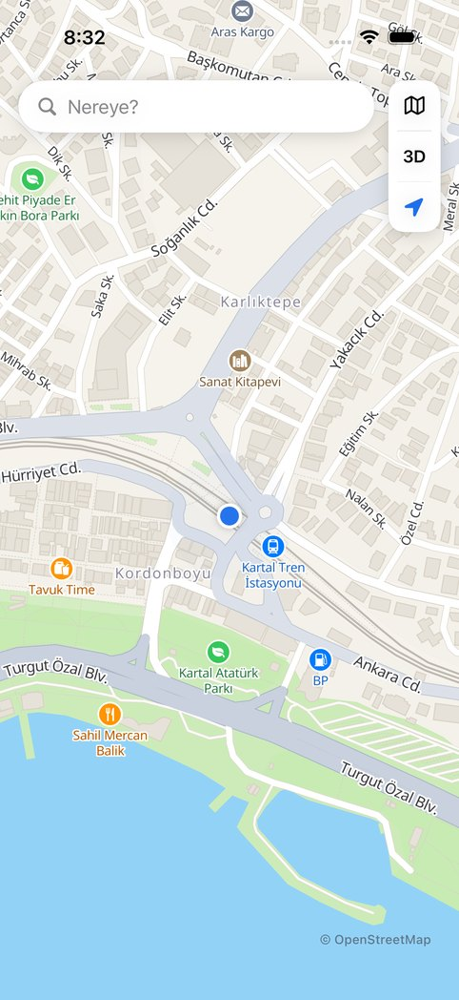
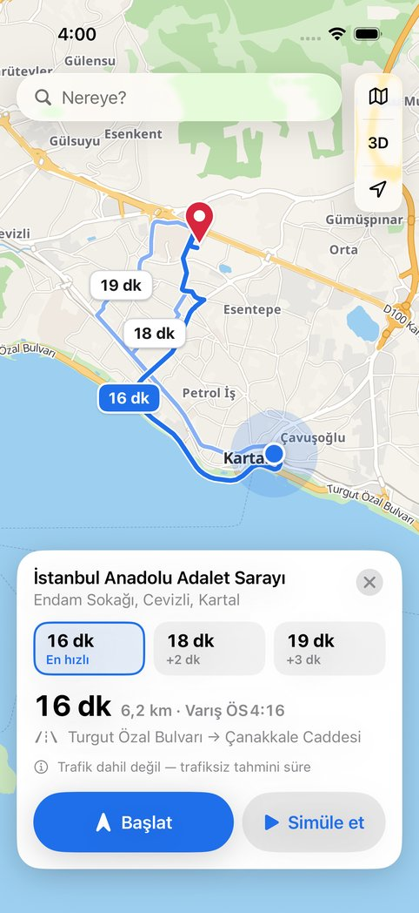
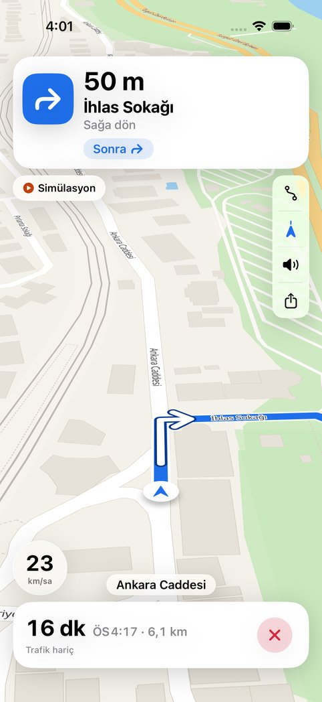
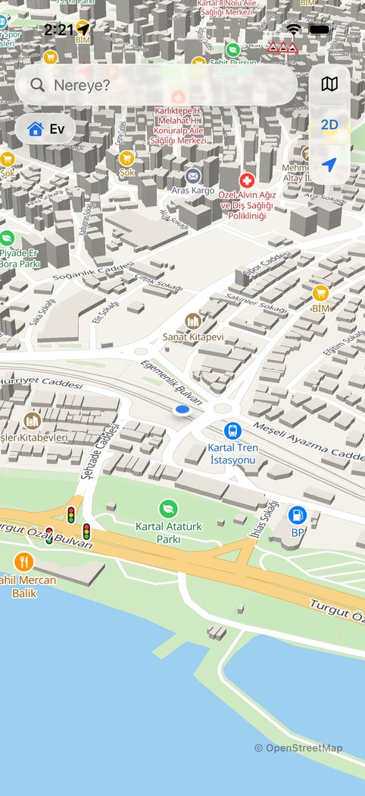
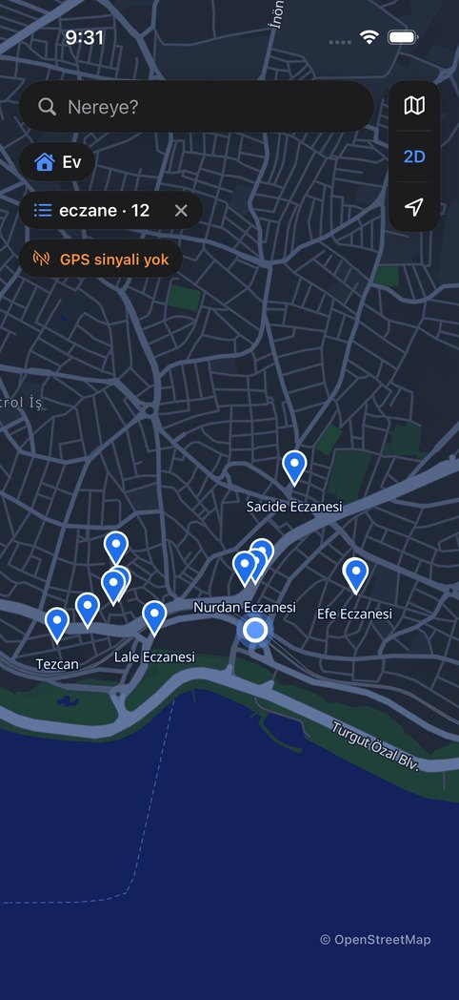
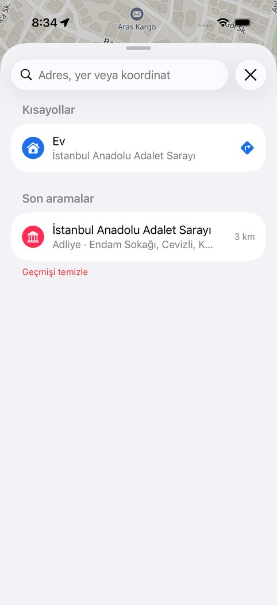

# ATLAS

**A navigation app for iPhone, built for Istanbul.** Turn-by-turn guidance in Turkish, live traffic, offline maps and routing for the whole city, and the details local drivers look for: speed cameras, speed bumps, traffic lights and road closures.

[](https://github.com/Vivi190/ViviMap/actions/workflows/ci.yml)


[Türkçe](README.tr.md)

<p align="center">
  
  
  
</p>
<p align="center">
  
  
  
</p>
<p align="center"><sub>CI screenshots from the iOS simulator in Kartal, Istanbul. Live traffic is not shown: CI builds run without a traffic key.</sub></p>

## Features

**Navigation**
- Turn-by-turn guidance on [Ferrostar](https://github.com/stadiamaps/ferrostar) with routes from [Valhalla](https://github.com/valhalla/valhalla): alternatives, automatic rerouting, and guidance that continues with the screen locked.
- Choosing a route as in Apple Maps and Yandex: each option's time in a bubble on the map (tap one to choose it), the options side by side with how much slower each is, tolls and ferries flagged. Routes can keep off toll roads and off car ferries.
- Turkish voice prompts written from the maneuver data: *"300 metre sonra ışıklarda sağa dönün, Ankara Caddesi."*
- A turn arrow on the route, a route line that starts under the car, the position snapped to the road, the name of the street you are on, zoom that follows speed and the next turn, the follow-up maneuver, and lanes where they are mapped.
- Routes to airports, hospitals and malls end on the road in front of them, not in the middle of the site.
- A Live Activity on the lock screen and in the Dynamic Island.

**Traffic** (HERE Traffic API v7)
- Green-to-red roads across the map, a traffic score for the area on screen, and road closures, accidents and road works.
- Route times with live traffic, slow stretches coloured on the route, and a "faster route" offer while driving that does not flip back and forth.
- A monthly request budget per device keeps usage inside the provider's free tier.

**Search**, tuned for Istanbul (Photon, OpenStreetMap, Overture Maps)
- Businesses by name, nearest first, also without a connection: an on-device index of 390 000 shops, restaurants, offices and services from the open places data of Overture Maps. They show as badges on the map at street zoom (a plain dot where the kind is unknown), and their cards carry phone number and website where the data has them.
- Addresses as people write them: *"Yakacık Mah. Atatürk Cad. No:12 D:5 Kartal/İstanbul"*.
- Kinds of places near you (*"benzinlik"*, *"en yakın eczane"*), in a district (*"esentepe eczane"*), and car parks around a destination, İSPARK's with their free spaces right now.
- Charging stations from the energy regulator's register: Istanbul's 1 800 public stations with their fastest current and their sockets (*"şarj"*, *"zes"*).
- Measured against OpenStreetMap: the first result is the intended place for 64 of 64 benchmark queries ([report](docs/research/2026-11-14-arama-olcumu.md), in Turkish).

**Offline**
- All of Istanbul ships with the app: vector tiles (PMTiles), on-device Valhalla routing and a search index. When the connection drops, the map, search, routing and rerouting carry on.

**Driver aids**
- Speed cameras, speed bumps and traffic lights from OpenStreetMap, on the map and as spoken warnings; the posted speed limit and an over-speed warning; your own camera and bump marks.

**Map**
- Custom day and night styles on the OpenMapTiles schema, with Apple Maps-style place badges, road number shields and 3D buildings.

## Architecture

The app target is thin; the work lives in Swift packages under `Packages/AtlasKit`.

| Module | Role |
|---|---|
| `MapEngine` | MapLibre map, styles, place badges and road signs, camera tracking |
| `SearchEngine` | Photon search and ranking, address normalization, offline search index |
| `RoutingEngine` | Valhalla routing (FOSSGIS server, on-device fallback), route notes |
| `NavigationEngine` | Ferrostar session, Turkish instructions and voice, hazard warnings, turn arrow |
| `TrafficEngine` | HERE flow and incidents, traffic along a route, request budget |
| `LocationEngine` | Location updates and GPS quality |
| `RoadHazards` | Bundled cameras, bumps and traffic lights; the driver's own marks |
| `TripHistory` | Predicted against actual trip times, personal calibration |
| `AppCore`, `DesignSystem`, `Diagnostics`, `NavigationActivity` | Settings and formatting, UI components, GPS diagnostics, Live Activity |

Decisions and trade-offs are recorded in [docs/architecture.md](docs/architecture.md); the roadmap and open items in [docs/development-plan.md](docs/development-plan.md).

```
App/                  iOS app target: screens, assets, UI tests
Packages/AtlasKit/    Swift packages (see above) and their tests
Tools/                Map styles, app icon, OpenStreetMap extracts, search benchmark
docs/                 Architecture, development plan, research, TestFlight setup
project.yml           XcodeGen project definition
.github/workflows/    CI, TestFlight, offline data, search benchmark
```

## Quality

- Every push to `main` builds the app, runs the unit tests (150+) and takes UI screenshots on the iOS simulator. The tests include simulated drives on a real Kartal route with live routing (arrival, rerouting, snapped position) and a long drive with a memory check.
- The screenshots are reviewed before each TestFlight build; changes per build are listed in the [changelog](CHANGELOG.md).
- Search quality is measured with a benchmark against OpenStreetMap (`Tools/searchbench`).

## Building

No Mac is needed: GitHub Actions builds, tests and ships to TestFlight.

- `ci.yml` runs on every push: build, unit tests and UI screenshots (kept as artifacts).
- `testflight.yml` is started by hand: it signs and uploads a build with the offline Istanbul data embedded.
- `offline-data.yml` builds the offline tiles, routing graph and search index from OpenStreetMap, and the business index from Overture Maps.

On a Mac: `brew install xcodegen`, run `xcodegen`, then open `Atlas.xcodeproj`. Without a HERE key the app runs with traffic hidden. Signing certificates and API keys live only in GitHub Secrets; see [docs/setup-testflight.md](docs/setup-testflight.md).

## Privacy

No accounts, analytics or tracking. Saved places and trip history stay on the phone. To do its job the app sends search text and your location to Photon (to rank nearby results), start and destination to Valhalla, route shapes and map areas to HERE for traffic, and requests map tiles for the area on screen from OpenFreeMap. No identifiers are sent. Businesses are searched on the phone. A list of car parks asks Istanbul's open data service for İSPARK's free spaces: one request for the whole city, with no position in it. A place card can open the place in Google Maps or Yandex Maps for its reviews; only then, and only when asked, does the place's name and position go to that service. A pasted short link of Google Maps is asked of Google once, to learn where it leads: the link goes, nothing else.

## Data and acknowledgements

- Map data © [OpenStreetMap](https://www.openstreetmap.org/copyright) contributors, ODbL. Tiles by [OpenFreeMap](https://openfreemap.org) (OpenMapTiles schema); offline tiles built with [Planetiler](https://github.com/onthegomap/planetiler).
- Search by [Photon](https://github.com/komoot/photon) (komoot). Routing by [Valhalla](https://github.com/valhalla/valhalla), on the FOSSGIS public server and on the device through [valhalla-mobile](https://github.com/Rallista/valhalla-mobile).
- Traffic © HERE.
- Free spaces in İSPARK car parks, the list of signalised junctions and the public charging stations (the energy regulator's register) from the [İBB Open Data Portal](https://data.ibb.gov.tr/license) (İBB Açık Veri Lisansı). The junction list and the charging-station list in this repository (`junctions-istanbul.json`, `chargers-istanbul.json`) are İstanbul Büyükşehir Belediyesi's data under that licence.
- Businesses from the places theme of the [Overture Maps Foundation](https://docs.overturemaps.org/attribution/): records from Meta, Microsoft and others (CDLA-Permissive-2.0), Foursquare (Apache-2.0) and AllThePlaces (CC0-1.0).
- The OpenStreetMap extracts in this repository (speed cameras, speed bumps, traffic lights, test fixtures) are © OpenStreetMap contributors, ODbL.
- Built with MapLibre Native (BSD-2-Clause), MapLibre SwiftUI DSL (BSD-3-Clause), Ferrostar (BSD-3-Clause) and valhalla-mobile (MIT).

## License

All rights reserved: the source is public to be read, not reused. See [LICENSE](LICENSE); third-party components and OpenStreetMap data keep their own licenses.
