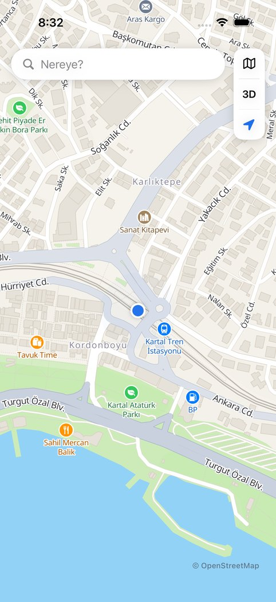
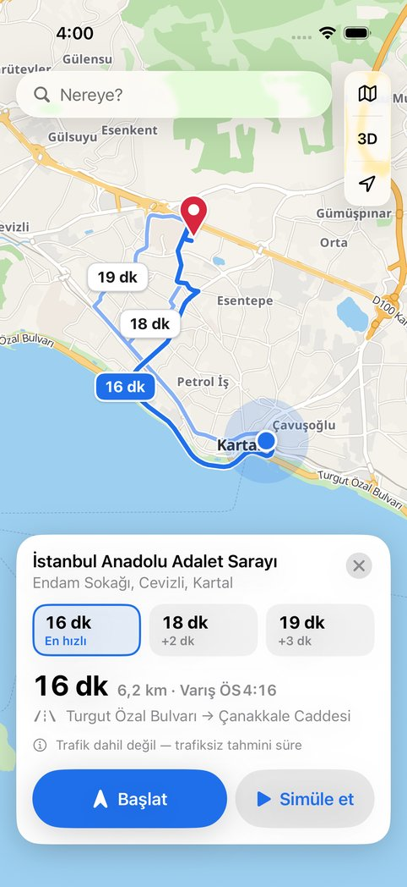
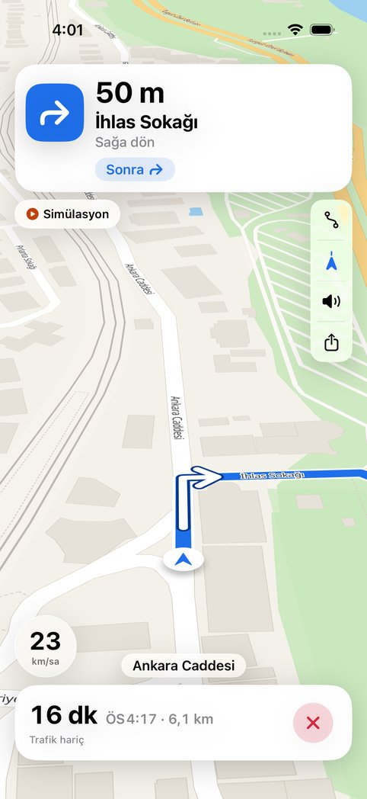
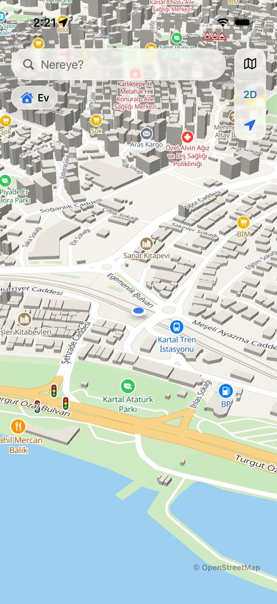
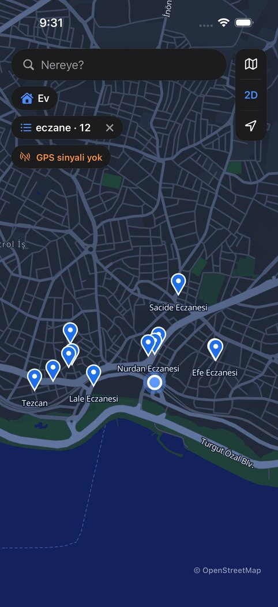
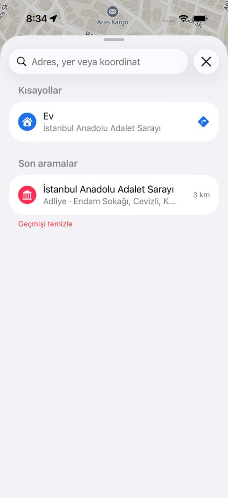

# ATLAS

**İstanbul için yapılmış bir iPhone navigasyon uygulaması.** Türkçe adım adım yönlendirme, canlı trafik, bütün şehir için çevrimdışı harita ve rota, ve yerel sürücülerin aradığı ayrıntılar: hız kameraları, kasisler, trafik ışıkları ve kapalı yollar.

[](https://github.com/Vivi190/ViviMap/actions/workflows/ci.yml)


[English](README.md)

<p align="center">
  
  
  
</p>
<p align="center">
  
  
  
</p>
<p align="center"><sub>iOS simülatöründe, İstanbul Kartal'da alınmış CI ekran görüntüleri. Canlı trafik görünmüyor, çünkü CI derlemeleri trafik anahtarı olmadan çalışıyor.</sub></p>

## Özellikler

**Navigasyon**
- [Ferrostar](https://github.com/stadiamaps/ferrostar) üzerinde, [Valhalla](https://github.com/valhalla/valhalla) rotalarıyla adım adım yönlendirme: alternatifler, otomatik yeniden rota, ekran kilitliyken de süren yönlendirme.
- Apple Haritalar ve Yandex'teki gibi rota seçimi: her seçeneğin süresi haritada bir baloncukta (dokununca seçilir), seçenekler yan yana ve her birinin ne kadar yavaş olduğu, ücretli geçiş ve feribot uyarısı.
- Manevra verisinden yazılan Türkçe sesli yönlendirme: *"300 metre sonra ışıklarda sağa dön, Ankara Caddesi."*
- Rota üzerinde dönüş oku, aracın altından başlayan rota çizgisi, yola oturtulmuş konum oku, üzerinde olunan yolun adı, hıza ve dönüşe göre yakınlaşma, ardışık manevra ve verisi olan yollarda şeritler.
- Havalimanı, hastane ve AVM rotaları alanın ortasında değil, önündeki yolda biter.
- Kilit ekranında ve Dynamic Island'da Live Activity.

**Trafik** (HERE Traffic API v7)
- Haritada yeşilden kırmızıya yollar, görünen bölgenin trafik puanı, kapalı yollar, kazalar ve yol çalışmaları.
- Canlı trafikle rota süreleri, rota üzerinde renklenen yavaş kesimler ve sürüşte gidip gelmeyen "daha hızlı rota" önerisi.
- Cihaz başına aylık istek bütçesi, kullanımı sağlayıcının ücretsiz kotasında tutar.

**Arama**, İstanbul'a göre ayarlı (Photon, OpenStreetMap)
- Adresler insanların yazdığı gibi: *"Yakacık Mah. Atatürk Cad. No:12 D:5 Kartal/İstanbul"*.
- Yakındaki yer türleri (*"benzinlik"*, *"en yakın eczane"*), bir semtte (*"esentepe eczane"*) ve hedefin çevresindeki otoparklar.
- OpenStreetMap'e karşı ölçüldü: ölçüm sorgularının 64'ünde 64'ünde ilk sonuç kastedilen yer ([rapor](docs/research/2026-11-14-arama-olcumu.md)).

**Çevrimdışı**
- İstanbul'un tamamı uygulamayla gelir: vektör karolar (PMTiles), cihazda Valhalla rotası ve arama dizini. Bağlantı kesilince harita, arama, rota ve yeniden rota devam eder.

**Sürüş yardımcıları**
- OpenStreetMap'ten hız kameraları, kasisler ve trafik ışıkları, haritada ve sesli uyarı olarak; levhadaki hız sınırı ve hız aşımı uyarısı; kendi kamera ve kasis işaretlerin.

**Harita**
- OpenMapTiles şemasında özgün gündüz ve gece stilleri: Apple Haritalar tarzı yer rozetleri, yol numarası tabelaları ve 3D binalar.

## Mimari

Uygulama hedefi ince; asıl iş `Packages/AtlasKit` altındaki Swift paketlerinde.

| Modül | Görevi |
|---|---|
| `MapEngine` | MapLibre haritası, stiller, yer rozetleri ve yol işaretleri, kamera takibi |
| `SearchEngine` | Photon araması ve sıralama, adres yazımı, çevrimdışı arama dizini |
| `RoutingEngine` | Valhalla rotası (FOSSGIS sunucusu, cihazda yedek), rota notları |
| `NavigationEngine` | Ferrostar oturumu, Türkçe talimat ve ses, uyarılar, dönüş oku |
| `TrafficEngine` | HERE akış ve olaylar, rota boyunca trafik, istek bütçesi |
| `LocationEngine` | Konum güncellemeleri ve GPS kalitesi |
| `RoadHazards` | Uygulamayla gelen kamera, kasis ve trafik ışıkları; sürücünün kendi işaretleri |
| `TripHistory` | Tahmini ve gerçekleşen sürüş süreleri, kişisel kalibrasyon |
| `AppCore`, `DesignSystem`, `Diagnostics`, `NavigationActivity` | Ayarlar ve biçimlendirme, arayüz bileşenleri, GPS tanılama, Live Activity |

Kararlar ve gerekçeleri: [docs/architecture.md](docs/architecture.md) (İngilizce); yol haritası ve açık işler: [docs/development-plan.md](docs/development-plan.md); cihaz testleri: [docs/device-testing.tr.md](docs/device-testing.tr.md).

```
App/                  iOS uygulama hedefi: ekranlar, varlıklar, UI testleri
Packages/AtlasKit/    Swift paketleri (yukarıda) ve testleri
Tools/                Harita stilleri, uygulama ikonu, OpenStreetMap kesitleri, arama ölçümü
docs/                 Mimari, geliştirme planı, araştırmalar, TestFlight kurulumu
project.yml           XcodeGen proje tanımı
.github/workflows/    CI, TestFlight, çevrimdışı veri, arama ölçümü
```

## Kalite

- `main`'e her push'ta uygulama derlenir, birim testleri (150+) çalışır ve iOS simülatöründe ekran görüntüleri alınır. Testlerde canlı rota motoruyla gerçek bir Kartal rotasında simüle sürüşler (varış, yeniden rota, yola oturtulmuş konum) ve bellek ölçümlü uzun bir sürüş var.
- Her TestFlight build'inden önce ekran görüntüleri incelenir; her build'in değişiklikleri [değişiklik günlüğünde](CHANGELOG.md).
- Arama kalitesi OpenStreetMap'e karşı bir ölçüm aracıyla ölçülür (`Tools/searchbench`).

## Derleme

Mac gerekmez: derlemeyi, testleri ve TestFlight'a yüklemeyi GitHub Actions yapar.

- `ci.yml` her push'ta çalışır: derleme, birim testleri ve ekran görüntüleri (artifact olarak saklanır).
- `testflight.yml` elle başlatılır: imzalar ve çevrimdışı İstanbul verisini gömerek yükler.
- `offline-data.yml` çevrimdışı karoları, rota grafiğini ve arama dizinini OpenStreetMap'ten üretir.

Mac'te: `brew install xcodegen`, `xcodegen`, sonra `Atlas.xcodeproj`'u aç. HERE anahtarı yoksa uygulama trafik gizli çalışır. İmza sertifikaları ve API anahtarları yalnızca GitHub Secrets'ta; bkz. [docs/setup-testflight.md](docs/setup-testflight.md).

## Gizlilik

Hesap, analiz ya da izleme yok. Kayıtlı yerler ve sürüş geçmişi telefonda kalır. Uygulama işini yapmak için arama metnini ve konumunu Photon'a (yakındaki sonuçları öne almak için), başlangıç ve hedefi Valhalla'ya, trafik için rota şeklini ve harita bölgesini HERE'ye gönderir; ekrandaki bölgenin harita karolarını OpenFreeMap'ten ister. Kimlik bilgisi gönderilmez.

## Veri ve teşekkür

- Harita verisi © [OpenStreetMap](https://www.openstreetmap.org/copyright) katkıcıları, ODbL. Karolar [OpenFreeMap](https://openfreemap.org) (OpenMapTiles şeması); çevrimdışı karolar [Planetiler](https://github.com/onthegomap/planetiler) ile üretilir.
- Arama [Photon](https://github.com/komoot/photon) (komoot). Rota [Valhalla](https://github.com/valhalla/valhalla); FOSSGIS'in ortak sunucusunda ve cihazda [valhalla-mobile](https://github.com/Rallista/valhalla-mobile) ile.
- Trafik © HERE.
- Bu depodaki OpenStreetMap kesitleri (hız kameraları, kasisler, trafik ışıkları, test verileri) © OpenStreetMap katkıcıları, ODbL.
- Kullanılan kütüphaneler: MapLibre Native (BSD-2-Clause), MapLibre SwiftUI DSL (BSD-3-Clause), Ferrostar (BSD-3-Clause), valhalla-mobile (MIT).

## Lisans

Tüm hakları saklıdır: kaynak kod incelemek için açık, yeniden kullanmak için değil. Bkz. [LICENSE](LICENSE); üçüncü taraf bileşenler ve OpenStreetMap verisi kendi lisanslarıyla gelir.
