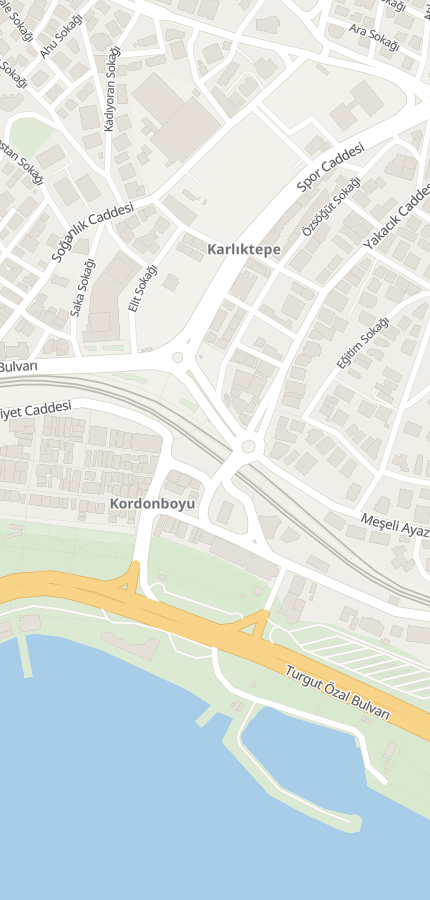
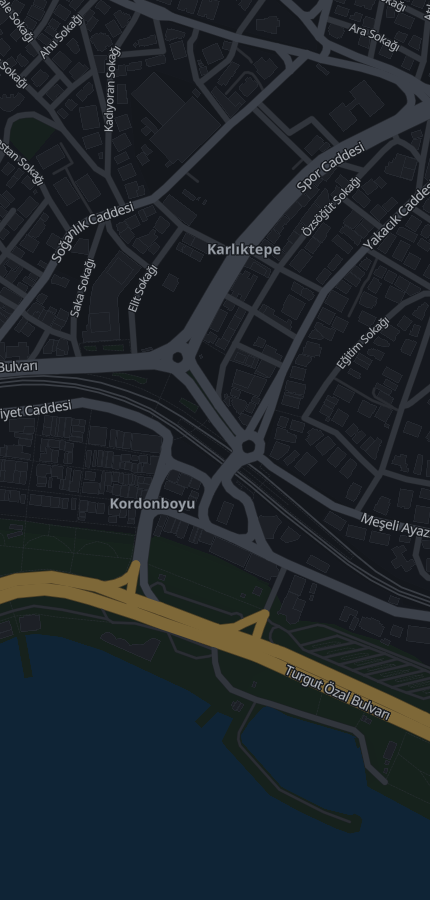
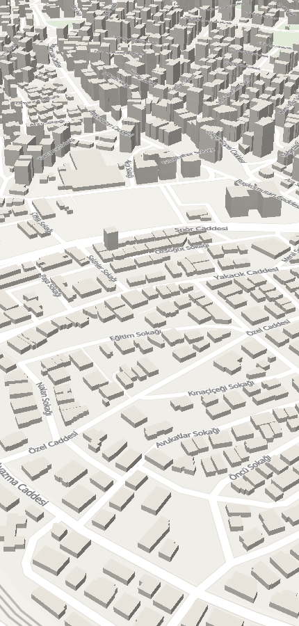
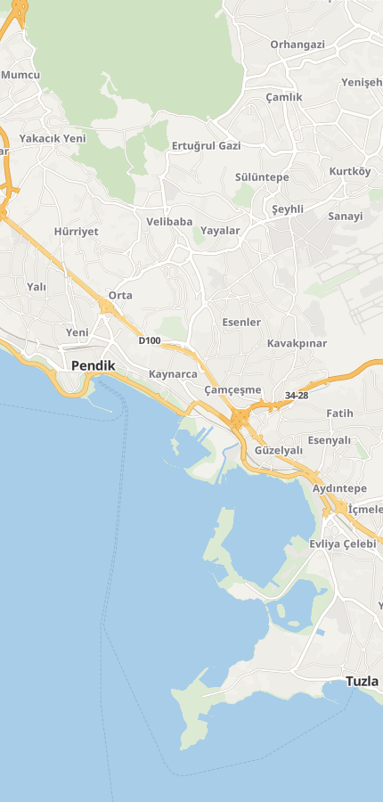

# ATLAS — Faz 0 Teknik Araştırma Raporu

**Tarih:** 13 Kasım 2026
**Kaynaklar:** GitHub API (`gh api`), resmi dokümanlar ve kullanım şartları, OSM Overpass/taginfo ölçümleri
**İşaret:** **DOĞRULANMADI** olarak işaretli bilgiler kontrol edilemedi. Bunlara dayanan kararlar ilgili fazda yeniden test edilecek.

---

## 1. Özet

### Kararlar

| Alan | Karar | Neden |
|---|---|---|
| Platform | Native Swift 6 + SwiftUI, iOS 17+ | Ferrostar, MapLibre, CarPlay, Live Activities ve CoreLocation'ın hepsi native Swift API. React Native ek köprü ve bakım yükü getirir, kişisel iPhone kullanımında hiçbir kazancı yok. |
| Harita | MapLibre Native iOS 7.0 + `maplibre/swiftui-dsl` 0.27 | BSD lisans, Metal, PMTiles ve offline paket desteği. Ferrostar'ın da kullandığı yığın. |
| Karo | OpenFreeMap (online, anahtarsız) → Planetiler ile kendi PMTiles (offline, Faz 4) | İkisi de aynı OpenMapTiles şeması, yani tek stil seti yeterli. |
| Navigasyon çekirdeği | Ferrostar 0.59+ (Faz 2) | BSD-3. Rust çekirdeği, rota takibi, sapma tespiti ve sesli talimat altyapısı hazır. |
| Routing | Valhalla: online sunucu + cihaz içi `valhalla-mobile` | Aynı motor iki tarafta çalışıyor, offline'a geçiş tutarlı kalıyor. |
| Trafik | **HERE** (onay bekliyor) | Kullanım şartları mimarimize uyan tek sağlayıcı (bkz. §6). |
| Arama | Photon (online) + SQLite FTS5 indeksi (offline) | Apple araması MapLibre haritasında **yasak** (bkz. §7). |
| Derleme | XcodeGen + GitHub Actions (`macos-26`, Xcode 26.6) | Mac yok; proje dosyası YAML'dan üretiliyor. |

### En önemli bulgular

1. **Valhalla'da canlı trafik ve alternatif rota aynı istekte alınamıyor.** Trafik için `date_time` gerekiyor, `date_time` ise alternatifleri kapatıyor. Bu yüzden mimari şöyle: rota adaylarını kendi motorumuz üretir, trafikli süreyi HERE ölçer, kararı kendi katmanımız verir (§6).
2. **İstanbul'da OSM verisi navigasyon için eksik** (§8, ölçüldü):
   - Hız sınırı, yol uzunluğunun yalnızca %9–16'sında var.
   - Dönüş şeridi verisi üç ilçede **sıfır**.
   - Hız kamerası Pendik'te 1, Kartal ve Tuzla'da 0.
   - Kasis sayısı gerçeğin çok altında.
3. **TomTom teknik olarak en iyi trafik API'si, ama şartları "navigasyon işlevini" ve CarPlay'i yazılı anlaşma olmadan yasaklıyor.** Google, Mapbox, Yandex MapKit ve Apple bu mimaride lisans gereği kullanılamıyor.
4. **Radar uyarısı hukuki gri alanda.** KTK md. 51 (7574 sayılı kanun, RG 27.02.2026) radar tespit/ikaz *cihazlarını* yasaklıyor; uygulamalar metinde geçmiyor. Kamera uyarısı proje sahibinin kararına bağlı (sonradan alındı: ADR-9).
5. **CarPlay navigasyon yetkisinin kişisel bir uygulamaya verilme ihtimali düşük ve ne zaman sonuçlanacağı belirsiz.** iOS 26'da Live Activity, CarPlay Dashboard'da yetki gerektirmeden görünebiliyor.

---

## 2. GitHub projeleri

Veriler 13.11.2026'da `gh api` ile çekildi.

| Proje | ⭐ | Lisans | Son sürüm | iOS | Offline | Değerlendirme |
|---|---:|---|---|---|---|---|
| [maplibre/maplibre-native](https://github.com/maplibre/maplibre-native) | 2.315 | BSD-2 | ios-v7.0.0 (28.10.2026) | ✅ | Offline paket + PMTiles | **Seçildi:** harita motoru |
| [maplibre/swiftui-dsl](https://github.com/maplibre/swiftui-dsl) | 116 | BSD-3 | v0.27.0 (10.11.2026) | ✅ | — | **Seçildi:** SwiftUI katmanı |
| [stadiamaps/ferrostar](https://github.com/stadiamaps/ferrostar) | 458 | BSD-3 | 0.59.0 (22.10.2026) | ✅ iOS 16+ | Özel rota sağlayıcıyla | **Seçildi:** navigasyon çekirdeği (Faz 2) |
| [valhalla/valhalla](https://github.com/valhalla/valhalla) | 6.449 | MIT | 3.9.1 (06.10.2026) | Mobil port üzerinden | ✅ | **Seçildi:** routing |
| [Rallista/valhalla-mobile](https://github.com/Rallista/valhalla-mobile) | 84 | MIT | 0.6.4 (06.10.2026) | ✅ SwiftPM, iOS 16.4+ | ✅ | **Seçildi:** cihaz içi routing (Faz 4) |
| [graphhopper/graphhopper](https://github.com/graphhopper/graphhopper) | 6.812 | Apache-2.0 (+LGPL/EDL parçalar) | 11.1 (29.09.2026) | ❌ (graphhopper-ios 2021'den beri ölü) | iOS'ta yok | Yedek sunucu motoru. 11.1 kritik bir güvenlik açığını kapatıyor; self-host edilecekse ≥11.1 şart. |
| [Project-OSRM/osrm-backend](https://github.com/Project-OSRM/osrm-backend) | 8.216 | BSD-2 | v26.11.0 (01.11.2026) | ❌ | — | Elendi: sesli/banner talimat üretmiyor; commit'lerin büyük kısmı tek geliştiriciden. |
| graphhopper/open-source-routing-engine | — | — | — | — | — | **Böyle bir depo yok (404).** Büyük ihtimalle açıklaması "Open source routing engine for OpenStreetMap" olan graphhopper/graphhopper kastedildi. |
| [Trufi-Association](https://github.com/Trufi-Association) | 117 (trufi-core) | — | — | Flutter | — | Toplu taşıma odaklı (OpenTripPlanner); araç navigasyonuyla ilgisiz. |
| [mapbox/mapbox-navigation-ios](https://github.com/mapbox/mapbox-navigation-ios) | 921 | Tescilli (Mapbox ToS) | 3.35.0 | ✅ | Sınırlı | Elendi: ToS §2.9.1 mobilde Mapbox SDK'sını tek erişim yolu yapıyor, MapLibre ile birlikte kullanılamaz. |
| [maplibre/maplibre-navigation-ios](https://github.com/maplibre/maplibre-navigation-ios) | 68 | NOASSERTION | 4.1.1 | ✅ | — | Eski Mapbox nav fork'u; Ferrostar'ın yedeği. |
| [organicmaps/organicmaps](https://github.com/organicmaps/organicmaps) | 15.960 | Apache-2.0 kod + ayrı veri lisansı | 2026.11.11 | Yalnızca kendi uygulaması | ✅ | Kütüphane olarak kullanılamaz (SDK yok, `.mwm` formatına bağlı). Alternatif rota da yok. Referans olarak faydalı. |
| CoMaps ([Codeberg](https://codeberg.org/comaps/comaps)) | — | Apache-2.0 | v2026.11.07 | Yalnızca kendi uygulaması | ✅ | Organic Maps fork'u (Mayıs 2025). Aynı sınırlamalar. |
| [komoot/photon](https://github.com/komoot/photon) | 3.190 | Apache-2.0 | 1.3.0 (07.08.2026) | Sunucu | — | **Seçildi:** online arama. Yazarken arama destekliyor, Türkiye dökümü 142,9 MB. |
| [pelias/pelias](https://github.com/pelias/pelias) | 3.605 | MIT | — | Sunucu | — | Elendi: Elasticsearch + libpostal (~4 GB) + 8 GB+ RAM; tek kullanıcı için fazla ağır. |
| [osm-search/Nominatim](https://github.com/osm-search/Nominatim) | 4.562 | GPL-3.0 | v5.3.3 | Sunucu | — | Public sunucuda autocomplete **yasak**; yalnızca ters geocoding ve elle başlatılan arama için. |
| [hyperknot/openfreemap](https://github.com/hyperknot/openfreemap) | 6.410 | — | — | — | — | **Seçildi:** online vektör karo. |
| [onthegomap/planetiler](https://github.com/onthegomap/planetiler) | 2.250 | Apache-2.0 | v0.10.2 | — | — | Offline karo üretimi (Faz 4). |
| [protomaps/PMTiles](https://github.com/protomaps/PMTiles) | 3.108 | — | — | MapLibre Native destekliyor | ✅ | Tek dosyalık offline karo arşivi (Faz 4). |
| [yonaskolb/XcodeGen](https://github.com/yonaskolb/XcodeGen) | 8.951 | MIT | 2.46.0 | — | — | **Seçildi:** Windows'tan Xcode projesi yönetimi. |
| [maplibre/maplibre-react-native](https://github.com/maplibre/maplibre-react-native) | 676 | MIT | v11.5.1 | ✅ | — | Elendi: bkz. §3. |
| [headwaymaps/headway](https://github.com/headwaymaps/headway) | 3.020 | Apache-2.0 | — | — | — | Kendi sunucunda çalışan tam harita yığını; referans mimari. |

---

## 3. Native SwiftUI ve React Native karşılaştırması

| Ölçüt | Native (Swift/SwiftUI) | React Native |
|---|---|---|
| Ferrostar | Doğrudan SwiftPM | Köprü yazmak gerekir |
| CarPlay, Live Activities, AVSpeech, CoreLocation | Birinci sınıf API | Native modül yazmak gerekir |
| Harita performansı | MapLibre doğrudan Metal'le çizer | Aynı motor + JS köprüsü |
| Android | — | Avantaj, ama bu projenin hedefi değil |

**Karar:** Native. React Native'in tek getirisi Android desteği, bu da kişisel iPhone kullanımında anlamsız.

---

## 4. Harita motoru ve karolar

- **MapLibre Native iOS 7.0.0:**
  - Minimum iOS 15.5.
  - Swift tarafında kırıcı değişiklik yok (yalnızca `Mapbox.h` → `MapLibre.h`).
  - Yeni: `global-state` ifadeleri (stili yeniden yüklemeden gece/gündüz geçişi için uygun), Lab/HCL renk interpolasyonu, döndürülmüş haritada 3D bina ışığı düzeltmesi.
  - PMTiles (`pmtiles://`) ve mbtiles kaynakları destekleniyor.
- **swiftui-dsl:**
  - 0.27.0 MapLibre 7'ye geçti.
  - Ferrostar 0.59.0'ın `Package.resolved` dosyası ise swiftui-dsl 0.26.1 ve MapLibre 6.22.1 kullanıyor. **Faz 2 riski:** Ferrostar'ın 0.27 ile derlenip derlenmediği CI'da doğrulanacak; gerekirse 0.26.1'e sabitlenecek.
  - DSL'de her harita jesti kamera takibini bırakıyor. Apple Haritalar'da yakınlaştırma takibi bozmuyor; bu fark Faz 6'da iyileştirilecek.
- **OpenFreeMap (test edildi):**
  - Anahtar gerekmiyor. Planet build 01.11.2026 tarihli, maxzoom 14.
  - `name:tr` alanı var; `transportation` katmanında `toll`, `expressway`, `oneway`, `ramp`, `brunnel` alanları bulunuyor.
  - Fontlar: Noto Sans Regular, Bold ve Italic. Birleşik font yığınları (`"A,B"`) **404** döndürüyor, bu yüzden her katmanda tek font kullanılıyor.
- **Özgün stiller:**
  - `Tools/mapstyle/build_styles.py` tek bir katman tanımından gündüz ve gece paletini üretiyor (69 katman).
  - Resmi `gl-style-validate` (v26.7.0) ile doğrulandı. Validator'ın gerçekten hata yakaladığı, kasıtlı bozulmuş bir stille ayrıca test edildi.
  - Pendik, Kartal ve Tuzla'da MapLibre GL JS ile render edilip kontrol edildi.
  - Bu kontrolde bir sorun bulundu ve düzeltildi: 3D binalar 2D görünümde bile perspektif yüzünden duvar gösterip yoğun mahalleleri "gürültüye" çeviriyordu. Artık 2D'de düz bina katmanı, 3D modda extrusion katmanı kullanılıyor.

Önizlemeler MapLibre GL JS ile alındı (iPhone'daki MapLibre Native render'ı küçük farklar gösterebilir):

| Gündüz — Kartal sahili, z15.6 | Gece — aynı yer | 3D — 55° eğim | Genel — Pendik–Tuzla, z11.6 |
|---|---|---|---|
|  |  |  |  |

---

## 5. Routing

### Valhalla 3.9.1

- **Seçenekler:** `use_highways`, `use_tolls`, `use_living_streets`, `maneuver_penalty`, araç yüksekliği/ağırlığı (auto/truck), `top_speed`, `shortest`, `linear_cost_factors` (3.9 ile geldi; belirli yolları pahalı/ucuz yapma).
- **Alternatifler:** sunucu varsayılanı en fazla 2. **Zamana bağlı (`date_time`) isteklerde ve 2'den fazla noktada alternatif yok.** #6042 numaralı çözüm denemesi birleştirilmeden kapatıldı.
- **Trafik:** canlı trafik `traffic.tar` dosyasıyla, tarihsel trafik haftanın her 5 dakikası için hız profilleriyle (CSV → DCT-II). Canlı hız yalnızca geçerli bir `date_time` ile kullanılıyor.
- **OSRM formatı:** banner ve sesli talimat, `intersections[].lanes`, `maxspeed` anotasyonları. Ferrostar'ın Valhalla adaptörü bunları hazır tüketiyor.
- **Türkçe:** `tr-TR` var, ancak 734 girdinin 135'i boş ve İngilizceye düşüyor. Eksik olanlar arasında "düz devam", isimsiz köprü/tünel ve bazı çıkış ifadeleri var. **Sonuç:** Türkçe talimat metinlerini manevra verisinden kendimiz üreteceğiz (Faz 2, VoiceGuidance).
- **Map matching:** `trace_route` / `trace_attributes` (Meili).

### Cihaz içi (offline)

- **valhalla-mobile 0.6.4:** SwiftPM, iOS 16.4+, önceden derlenmiş 21,9 MB xcframework; CI C++ derlemez. Karolar cihaz dışında `valhalla_build_tiles` ile üretiliyor.
- **Ferrostar'da resmi bir offline sağlayıcı yok.** Belgelenen yol: `CustomRouteProvider` + OSRM ayrıştırıcı. Online'dan offline'a geçiş isteği (#18) 2023'ten beri açık.
- **Boyutlar:**
  - Geofabrik Türkiye PBF: 623 MB.
  - Valhalla Türkiye karoları: tahminen 0,6–0,75 GB (**DOĞRULANMADI**, Faz 4'te CI'da ölçülecek).
  - BBBike'ın hazır İstanbul extract'ı **Pendik ve Tuzla'yı kapsamıyor**, bu yüzden kendi sınır kutumuzla keseceğiz.

### Online barındırma

| Seçenek | Maliyet | Sınırlar |
|---|---|---|
| FOSSGIS Valhalla (public) | Ücretsiz | Saniyede 1 istek, "makul kullanım"; uygulamalar `X-Client-Id` göndermeli. Yalnızca geliştirme için. |
| Stadia Maps (barındırılan Valhalla) | Ücretsiz plan: 200k kredi/ay ≈ 10k rota | Kişisel ve ticari olmayan kullanım. Trafik profili için Standard plan gerekiyor ($80/ay). Anahtar uygulamaya gömülmemeli. |
| Kendi Valhalla sunucumuz | Hetzner ≈ €5,49/ay; Oracle Always Free ARM (2 OCPU / 12 GB) | Türkiye için gereken RAM, disk ve derleme süresi **DOĞRULANMADI**. |

---

## 6. Trafik sağlayıcıları ve lisanslar

| Sağlayıcı | İstanbul | Harici rotayı değerlendirme | Ücretsiz kota (Kas 2026) | Kritik şart | Karar |
|---|---|---|---|---|---|
| **HERE** | Türkiye akış ✅, olay ✅ | ✅ `/v8/import` | Zamana duyarlı routing 5k/ay; import 2,5k/ay; trafik 5k/ay; vektör karo 30k/ay | §6.4(a): üçüncü taraf haritayla katmanlama ve rota birleştirme atıf vermek koşuluyla **serbest**. Önbellek ≤30 gün; veriyi değiştirme, ML/"algoritma optimizasyonu" ve kıyaslama yasak. | **Önerilen** |
| TomTom | Türkiye ✅ | ✅ `supportingPoints` + `reconstructionMode=track` | Routing 20k/ay, karo 200k/ay | §2.1: "Navigation Functionality" ve "Automotive Usage" (CarPlay dahil) **yazılı ayrı anlaşma olmadan hariç** | Ancak yazılı izinle |
| Google Routes | — | Yaklaşık (ara noktalarla) | 5k | §3.2.3(e) ve §19.2: Google dışı bir haritayla kullanım **yasak** | Engelli |
| Mapbox | Türkiye ✅ | Map Matching | 100k | §2.9.1: mobilde yalnızca Mapbox SDK'sı kullanılabilir; araç kullanımı ek lisans istiyor | Engelli |
| Yandex MapKit | Türkiye ✅ | — | ≤1.000 DAU | §2.4: "navigasyon uygulaması oluşturmak" **yasak** | Engelli |
| Yandex Route Details (HTTP) | ✅ | — | Ücretsiz kota yok, yıllık en az **$2.000** | Önbellek ≤30 gün | Pahalı |
| Apple | — | — | — | DPLA Ek 6 §2.4: harita verisi yalnızca Apple haritasında gösterilebilir | Engelli |

**Hiçbir ticari sağlayıcı kendi trafiğini Valhalla'ya beslemeye izin vermiyor.** Kendi motorumuzun tarihsel hızları şu kaynaklardan gelecek:

- **İBB "Saatlik Trafik Yoğunluk" verisi:**
  - Geohash-6 hücre (~0,6 × 0,9 km), Ocak 2020 – Ocak 2025 (güncellenmiyor).
  - Lisans: İBB Açık Veri Lisansı. Ticari kullanım ve uyarlama serbest, atıf zorunlu.
  - Sınırları: yön ayrımı yok; D-100 ana yolu ile yan yolları aynı hücreye düşüyor. Ancak kaba bir ön bilgi olarak kullanılabilir.
- **İBB UYM trafik duyuruları:** yol çalışması, kaza ve kapanma bilgisi (CSV, toplu; canlı değil).
- **Kendi sürüş izlerimiz:** asıl kalibrasyon kaynağı.
- İBB'nin canlı segment hız uç noktaları belgelenmemiş ve açık lisanslı değil. Kullanmak için İBB'den izin istenmeli.

### Önerilen yasal kombinasyon (onay bekliyor)

- **(a) Canlı trafikli süre ve alternatifler:**
  - HERE `/v8/routes`, alternatiflerle birlikte.
  - Kendi Valhalla adaylarımız HERE `/v8/import` ile ya da daha ucuz olan ara-nokta `/routes` yöntemiyle puanlanır. Böylece süreler **aynı ölçekte** karşılaştırılır.
  - Ekranda "© HERE" atfı gösterilir.
- **(b) Haritada trafik katmanı:** HERE Traffic Vector Tile v2 (MapLibre uyumluluğu **DOĞRULANMADI**) ya da Traffic v7 akış verisi GeoJSON katmanı olarak çizilir.
- **(c) Tarihsel trafik:** İBB verisi + kendi izlerimiz. HERE çıktısı kendi modelimize **girmez** (§6.4(f)).

**Tahmini maliyet:** ayda 120 sürüş ve sürüş başına 2–3 dakikada bir kontrol varsayımıyla:

| Kurulum | Aylık maliyet |
|---|---|
| Yalnızca HERE alternatifleri | **$0** (ücretsiz kota içinde) |
| + her kontrolde 3 adayı `/v8/import` ile puanlama | **$8,5–35,8** |
| + 3 aday ara-nokta yöntemiyle | **$0,8–19** |

Bu rakamlar araştırmacı ajanın hesabı; canlı API testi yapılmadı.

---

## 7. Arama ve adres

- **Apple MapKit araması kullanılamaz.**
  - DPLA (son güncelleme 29.10.2026), Ek 6 §2.4: harita verisi "yalnızca Apple Maps Service üzerinden sağlanan bir Apple haritasında" gösterilebilir.
  - Bir adres sonucu gösteriliyorsa ilgili Apple haritası da gösterilmeli.
  - MapLibre haritasıyla bu şart karşılanamaz.
- **Photon:**
  - Public `photon.komoot.io` "makul limitlerde" kullanılabilir, yoğun kullanım engelleniyor. Geliştirme için yeterli.
  - Kalıcı çözüm: kendi Photon sunucumuz (Türkiye dökümü 142,9 MB; Java 21; RAM ihtiyacı **DOĞRULANMADI**).
  - Varsayılan `asciifolding` ı/İ/ş/ğ harflerini katlıyor, yani "Sehit Fethi" araması da eşleşir.
- **Nominatim:** saniyede en fazla 1 istek; autocomplete kesinlikle yasak. Yalnızca ters geocoding için.
- **Offline (Faz 4):**
  - CI'da Geofabrik verisinden SQLite FTS5 indeksi üretilir: sokaklar, mahalleler, POI'ler, `addr:*`.
  - Türkçe kısaltmalar eşanlamlı olarak eklenir: Cd./Cad./Caddesi, Sk./Sok., Mah./Mh.
  - Kapı numarası bulunamazsa sokağa düşülür ve sonuç "yaklaşık" olarak işaretlenir.
- **Kapı numarası gerçeği:**
  - OSM Türkiye'de 5,82 milyon binaya karşılık 250 bin `addr:housenumber` var (taginfo).
  - Pendik'te 24 bin binaya karşılık 2.572 adresli obje var.
  - Yani OSM ile kapı numarası araması çoğu zaman başarısız olur. Kalite 50 adreslik bir İstanbul test setiyle ölçülecek (Faz 2).

---

## 8. İstanbul OSM veri kapsamı (ölçüm)

Overpass API, 13.11.2026. Uzunluklar yol geometrisinden hesaplandı (km).

| Ölçüt | Pendik | Kartal | Tuzla |
|---|---:|---:|---:|
| Araç yolu ağı (km) | 1.378,7 | 665,7 | 964,7 |
| Hız sınırı olan yol (km / %) | 221,5 / **%16,1** | 87,0 / **%13,1** | 86,2 / **%8,9** |
| Ana yollar (km) | 340,1 | 131,5 | 312,3 |
| Ana yollarda hız sınırı (%) | %48,1 | %31,7 | %23,7 |
| Ana yollarda şerit sayısı (%) | %52,7 | %40,8 | %29,2 |
| Dönüş şeridi (`turn:lanes`) | **0** | **0** | **0** |
| Kasis/tümsek (nokta) | 100 | 57 | 60 |
| Hız kamerası (nokta) | 1 | 0 | 0 |
| Trafik ışığı (nokta) | 152 | 52 | 95 |
| Dönüş yasağı (relation) | 291 | 75 | 112 |
| Adresli obje / bina | 2.572 / 24.098 | 2.454 / 24.521 | 3.807 / 19.838 |

*Ana yollar: motorway, trunk, primary, secondary ve bağlantıları.*

- **`turn:lanes` sıfırı çapraz kontrol edildi:**
  - Aynı sorgu bounding box ile tekrarlandı ve Pendik'te yine 0 çıktı.
  - Aracın çalıştığını göstermek için İstanbul geneli de sorgulandı: 717 yolda `turn:lanes`, 337 yolda `turn:lanes:forward` var.
  - Türkiye genelinde (taginfo) 1.007 yolda `turn:lanes` var; buna karşılık 73.123 yolda `lanes` etiketi bulunuyor.
- **İstanbul geneli:** 184 hız kamerası ve 2.109 kasis noktası.

**Sonuçlar:**

- **Hız sınırı:** yolların çoğunda veri yok. Veri yoksa gösterge "bilinmiyor" der. Şehir içi yasal varsayılanı (50 km/sa) gösterilecekse açıkça "varsayılan" olarak işaretlenir.
- **Şerit yönlendirmesi:** bu ilçelerde OSM'den pratikte imkânsız. Veri yoksa şerit çizilmez.
- **Kasis ve kamera:** OSM tek başına yetersiz. Kendi işaretlediğin noktalar ana kaynak olacak.

---

## 9. CarPlay, arka plan, Live Activities

- **CarPlay navigasyonu** `com.apple.developer.carplay-maps` yetkisi istiyor.
  - Başvuru developer.apple.com/contact/carplay üzerinden yapılıyor.
  - Forumlarda 4–10 ay yanıtsız bekleyen başvurular var. Kişisel bir uygulama için ihtimal düşük ve ne zaman sonuçlanacağı belirsiz.
  - CarPlay simülatörü yalnızca Mac'te çalışıyor.
  - **Plan:** başvuru yapılsın ama hiçbir faz buna bağlı olmasın.
- **iOS 26:** Live Activity widget'ları, yetki gerekmeden CarPlay Dashboard'da görünebiliyor. Sonraki manevrayı oraya taşıyabiliriz (Faz 7).
- **Arka planda navigasyon için gerekenler:**
  - `UIBackgroundModes` içinde `location`; `allowsBackgroundLocationUpdates` bu olmadan çökertir.
  - Sesli talimat için `audio` modu.
  - `CLBackgroundActivitySession` (iOS 17) ve `CLServiceSession` (iOS 18).
- **Ses oturumu:** kategori `.playback`, mod `.voicePrompt`, seçenekler `.duckOthers` ve `.interruptSpokenAudioAndMixWithOthers`.
- **Live Activity sınırları:** veri en fazla 4 KB. En çok 8 saat aktif kalıyor, kilit ekranında 4 saat daha görünebiliyor (toplam 12 saat). Ayrı bir widget extension ve kendi bundle ID'si gerekiyor.

---

## 10. CI ve TestFlight (Mac olmadan)

- **Runner:**
  - `macos-26` = macOS 26.7.2 arm64; Xcode 26.0.1–26.6 (varsayılan 26.6); iOS simülatörleri 26.2, 26.4, 26.5.
  - xcbeautify ve fastlane hazır kurulu. XcodeGen kurulu değil (`brew install xcodegen`).
  - **28.04.2026'dan beri App Store Connect yalnızca Xcode 26+ ile yapılan build'leri kabul ediyor.** Bu yüzden macos-15 runner'ındaki varsayılan Xcode 16.4 kullanılamaz.
- **Ücret:**
  - Private repoda Free plan ayda $12, Pro plan $18 hak veriyor. macOS dakikası $0,062.
  - Bu, Free'de ayda ≈193, Pro'da ≈290 macOS dakikası demek.
  - Public repoda standart runner'lar ücretsiz.
  - Ödeme yöntemi tanımlı değilse kota bitince iş akışları durur, sürpriz fatura çıkmaz.
- **İmzalama: seçilen yöntem, Windows'ta OpenSSL ile üretilen dağıtım sertifikası (.p12) + profil, GitHub Secrets'ta.**
  - Neden diğerleri değil:
    - Xcode bulut imzalama Admin rollü anahtar istiyor ve her yeni runner'da geliştirme sertifikası biriktiriyor.
    - fastlane match ikinci bir depo ve ek parola getiriyor.
  - .p12 dosyası `-legacy` (3DES/SHA1) ile üretilmeli. OpenSSL 3'ün varsayılan formatını macOS keychain reddedebiliyor. Araştırma ajanı bu komutu bu makinede test etti.
- **TestFlight:** dahili testçiler için Beta App Review gerekmiyor. Build'ler 90 gün geçerli. `ITSAppUsesNonExemptEncryption=NO` ayarlandı.
- **Xcode Cloud:** ilk kurulum Mac'te Xcode gerektiriyor, bu yüzden şu an kullanılamaz.

---

## 11. Hukuki notlar

- **Radar ve kamera uyarısı:**
  - KTK md. 51 (7574 sayılı kanun, RG 27.02.2026, sayı 33181): radar "yerini tespit veya sürücüyü ikaz eden her türlü cihazın" üretimi, ithalatı ve araçta bulundurulması yasak. Bulundurma cezası 185.000 TL.
  - Uygulamalar metinde geçmiyor; hukukçular bu konuda ayrışıyor (gri alan).
  - EGM sabit radar ve EDS noktalarını harita olarak yayımlamış (NTV, 08.06.2025). Lisansı ve makine tarafından okunabilir olup olmadığı **DOĞRULANMADI**.
  - **Öneri:** kasis ve tehlike uyarıları serbest. Hız kamerası uyarısı yalnızca proje sahibinin açık kararıyla, yalnızca resmi sabit noktalar ve kullanıcının işaretlediği noktalar için.
- **Atıf:** OSM (ODbL), OpenMapTiles, OpenFreeMap; HERE kullanılırsa HERE; İBB verisi kullanılırsa İBB. Uygulamadaki "© OpenStreetMap" bağlantısı bu atıfları gösteriyor.

---

## 11b. Faz 2 ön testleri (13.11.2026, canlı istek)

**FOSSGIS Valhalla (`tr-TR`):**

- Pendik → Kartal: 4,9 km, trafiksiz 8,0 dk, 15 manevra; yanıt süresi 0,3 sn.
- Türkçe talimatlar **kullanılamaz durumda**:
  - Tekrar eden sözcükler: "Kübra Sokak *caddesinde*", "23 Nisan Caddesi *caddesine*".
  - Tek başına kalan "sol.".
  - Yanlış hâl eki: "sol yönelin" (doğrusu "sola yönelin").
  - → ADR-3 doğrulandı: Türkçe metin manevra verisinden bizim tarafımızda üretilecek.
- Tuzla merkez → Kartal sahil: 17,3 km, trafiksiz 26,9 dk, sahil hattından. `alternates: 2` istendi ama **hiç alternatif dönmedi**.
  - → ADR-5 doğrulandı: alternatifler Valhalla'nın kendi alternatiflerine bırakılmayacak, açık stratejilerle üretilecek (otoyol ağırlıklı / yerel sokak / koridor üzerinden ara nokta).
- Aydınlı'daki bir nokta "No path could be found" (hata 442) döndü; nokta muhtemelen kapalı bir tesis alanına düştü. → Hedef noktasını kamuya açık bir yola yapıştırma ve anlaşılır hata mesajı gerekiyor.

**Photon (public), 7 İstanbul sorgusu:**

- 5'i doğru: Kartal Adliyesi → Anadolu Adalet Sarayı; Ankara Caddesi Kartal; **Bağdat Caddesi 300** (kapı numarasıyla); Sabiha Gökçen; ASCII yazılmış "Sehit Fethi Caddesi" → Şehit Fethi Caddesi.
- 2'si sıralama hatası: "Pendik Marmaray" → Marmaray *Sokağı*; "Tuzla Belediyesi" → otobüs durağı.
- → Uygulama içinde OSM etiketine göre yeniden sıralama yapılacak (örneğin belediye binası ve istasyon üstte).

## 12. Doğrulanamayanlar

- Valhalla Türkiye karo boyutu, RAM ihtiyacı ve cihaz içi bellek kullanımı.
- `prioritize_bidirectional` ile zamana bağlı alternatif üretimi.
- HERE için: maksimum alternatif sayısı, kredi kartı gerekip gerekmediği, `/v8/import`'un canlı trafik süresi döndürüp döndürmediği, vektör karoların MapLibre uyumluluğu.
- TomTom ücretsiz kotasının "üretim" sayılıp sayılmadığı.
- Apple Haritalar'ın Türkiye'deki adres kalitesi.
- Photon'un Türkiye için RAM ihtiyacı.
- CarPlay başvurusunun kişisel uygulamalar için sonucu.
- Ferrostar 0.59'un swiftui-dsl 0.27 ile derlenip derlenmediği.

## 13. Başlıca kaynaklar

- **Valhalla:**
  - API: https://valhalla.github.io/valhalla/api/route/api-reference/
  - Tarihsel trafik: https://valhalla.github.io/valhalla/concepts/historical-traffic/
  - Türkçe dil dosyaları: https://github.com/valhalla/valhalla/tree/master/locales
- **Ferrostar:**
  - Rota sağlayıcıları: https://github.com/stadiamaps/ferrostar/blob/main/guide/src/route-providers.md
- **HERE ve TomTom şartları:**
  - HERE Platform Terms: https://www.here.com/en-gb/terms/here-platform-terms
  - TomTom: https://docs.tomtom.com/legal/terms-and-conditions
- **Diğer sağlayıcı şartları:**
  - Google: https://cloud.google.com/maps-platform/terms ve https://cloud.google.com/maps-platform/terms/maps-service-terms
  - Mapbox: https://www.mapbox.com/legal/product-terms
  - Yandex: https://yandex.com/dev/tariffs/doc/en/mapkit/terms/
  - Apple DPLA: https://developer.apple.com/support/terms/apple-developer-program-license-agreement/
- **İBB:**
  - Açık Veri Lisansı: https://data.ibb.gov.tr/license
  - Saatlik trafik yoğunluğu: https://data.ibb.gov.tr/dataset/hourly-traffic-density-data-set
- **Arama:**
  - Photon: https://github.com/komoot/photon
  - Nominatim kullanım politikası: https://operations.osmfoundation.org/policies/nominatim/
- **GitHub Actions:**
  - Runner imajları: https://github.com/actions/runner-images
  - Faturalandırma: https://docs.github.com/en/billing/concepts/product-billing/github-actions
- **Apple platformu:**
  - Xcode sürüm şartı: https://developer.apple.com/news/upcoming-requirements/
  - CarPlay Developer Guide: https://developer.apple.com/download/files/CarPlay-Developer-Guide.pdf
- **OSM verisi:**
  - Türkiye taginfo: https://taginfo.geofabrik.de/europe:turkey/
  - Geofabrik Türkiye: https://download.geofabrik.de/europe/turkey.html
